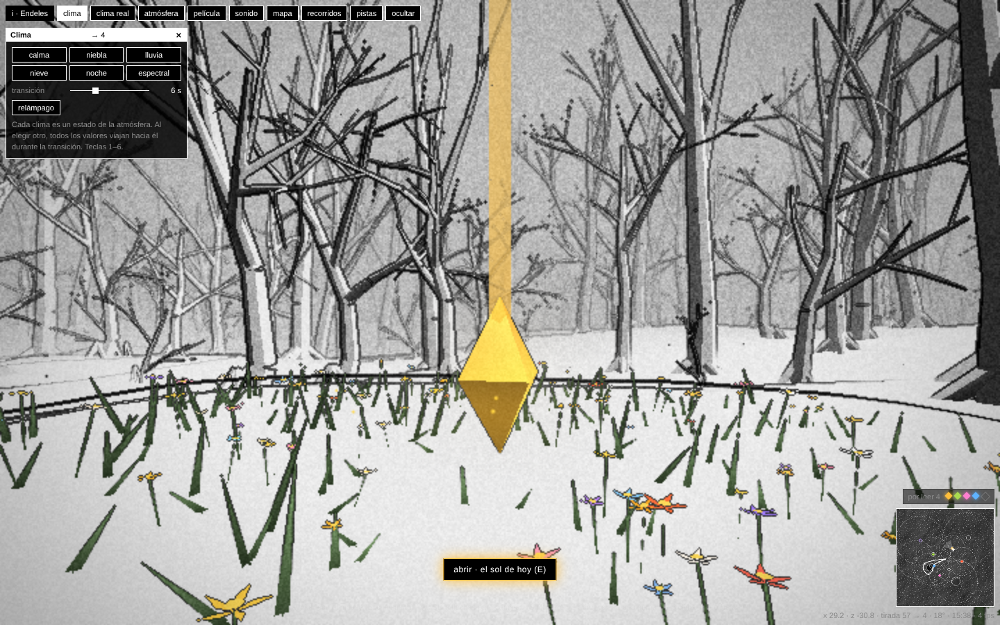
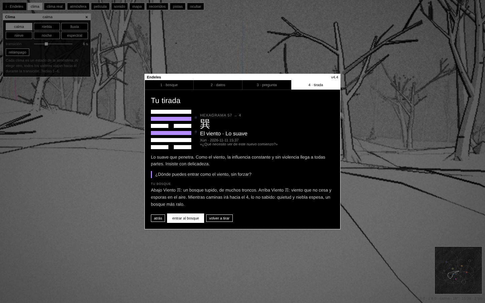
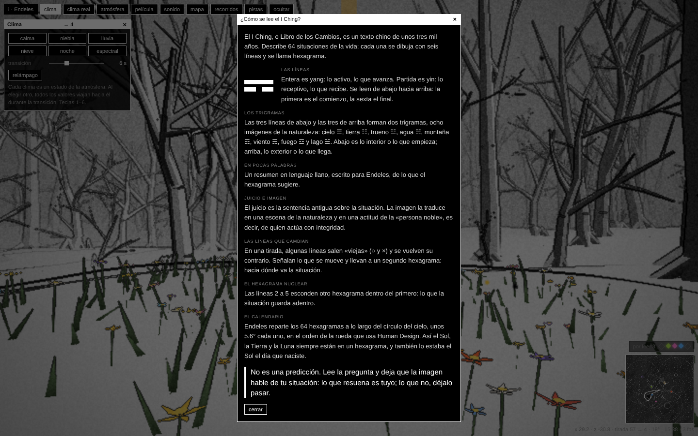
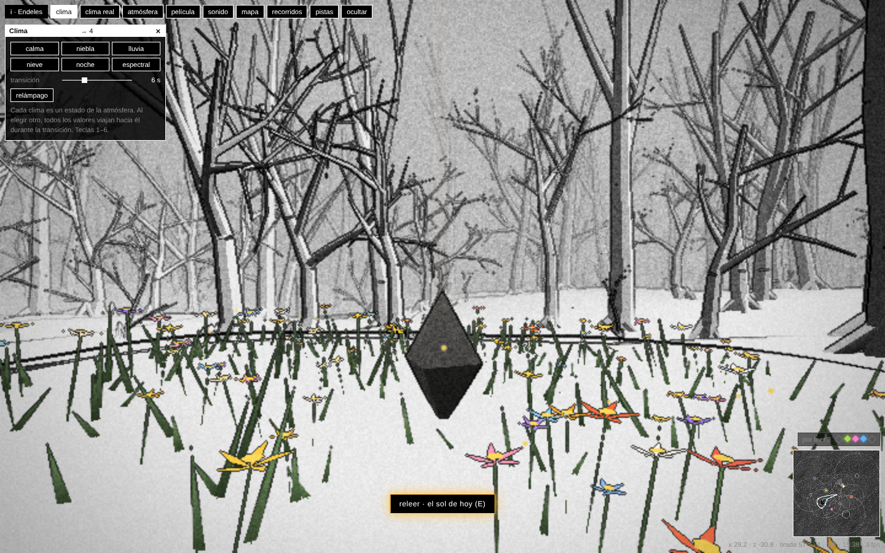
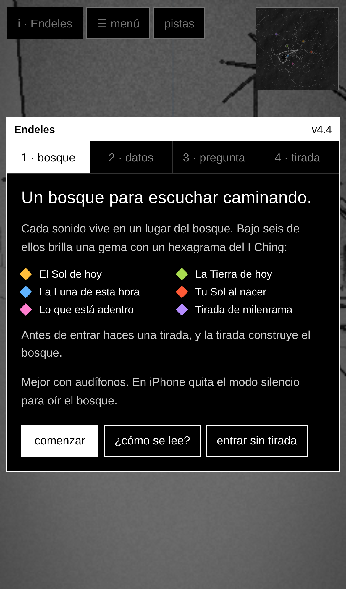
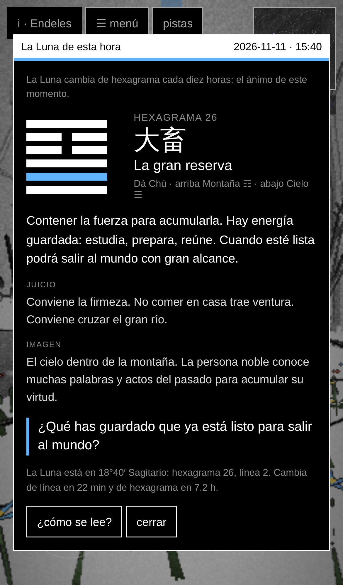

# Endeles

**Versión 4.4** · [Abrir en el navegador](https://loquellega.github.io/endeles/)

## Español

Endeles es un bosque espectral para escuchar caminando. Está hecho de árboles sin hojas, tinta, niebla y grano de película HP5. Cada sonido vive en un lugar del bosque: se oye a lo lejos, crece al acercarte y se mezcla con los demás.

Bajo seis de esos sonidos brilla una gema de color, lo único con color en el bosque gris. Cada una guarda un hexagrama del I Ching leído desde el cielo de este momento, desde tu nacimiento o desde tu tirada. Alrededor de cada gema crece un jardín de hierba, flores y polinizadores. Al leer una gema, se apaga y su luz pasa al jardín.

### Qué hace

- **Umbral en cuatro pasos:** el bosque, tus datos, tu pregunta y la tirada. Las seis líneas de milenrama construyen el bosque. El trigrama de abajo da el suelo, el de arriba la atmósfera, y las líneas que cambian lo transforman mientras caminas.
- **Seis gemas:** el Sol de hoy, la Tierra de hoy, la Luna de esta hora, tu Sol al nacer, lo que está adentro (el hexagrama nuclear de tu tirada) y la tirada misma.
- **I Ching en español:** versión libre de los 64 hexagramas desde el texto chino y la traducción de James Legge (1882), ambos de dominio público. Cada hexagrama trae «en pocas palabras», juicio, imagen y una pregunta de exploración. La guía «¿cómo se lee?» explica lo básico.
- **Misión:** apagar las gemas del día. Hay un contador junto al mapa y, al terminar, el bosque se llena de luciérnagas.
- **Sonido espacial binaural:** espacios sonoros con radio pleno y alcance, fauna que responde al clima (ranas, grillos según la temperatura, búho, cuervos, carpintero) y la posibilidad de cargar tus propios MP3.
- **Clima:** seis climas que se funden entre sí, o el clima real de un lugar vía Open-Meteo (temperatura, humedad, viento, lluvia, visibilidad, sol real y marea del estanque).
- **Película HP5:** grano, contraste, exposición y viñeta.
- **Mapa y recorridos:** generador de bosques por semilla, mapa grande editable, recorridos de cámara grabados o trazados, y exportar/importar todo en JSON.
- **Escritorio y teléfono:** mouse y teclado, o joystick táctil. En teléfono las ventanas salen como hoja inferior. La calidad gráfica se adapta para sostener la fluidez.

### Instalación y uso

Es una página estática: no necesita servidor propio ni base de datos.

1. Sube la carpeta completa a cualquier hosting, por ejemplo `/app/endeles/`, o usa GitHub Pages.
2. Ábrela por https. El audio y «mi ubicación» lo necesitan.
3. three.js va incluido en `lib/`. Sin internet funciona todo menos el clima real.

Controles de escritorio: clic para mirar con el mouse (Esc lo suelta), WASD o flechas para caminar, Shift para correr, E abre y cierra una gema, 1–6 cambia el clima, F la película, P reproduce un recorrido y H oculta la interfaz.

Para modificar la app, edita `desarrollo/src.html` o `fuente/*.js` y reconstruye con `python3 desarrollo/construir.py`. El detalle completo está en [LEEME.txt](LEEME.txt).

## English

Endeles is a spectral forest to listen to while walking. Its leafless trees are drawn in ink, fog and HP5 film grain. Every sound lives in a place: you hear it from afar, it grows as you approach and blends with the others.

Under six of those sounds glows a colored gem, the only color in the grey forest. Each one holds an I Ching hexagram read from the sky at this moment, from your birth or from your own reading. A garden of grass, flowers and pollinators grows around each gem. Once you read a gem it goes dark, and its light passes into the garden.

### Features

- **Four-step threshold:** the forest, your details, your question and the reading. Six yarrow-stalk lines build the forest. The lower trigram shapes the ground, the upper one the atmosphere, and changing lines transform it as you walk.
- **Six gems:** today's Sun, today's Earth, this hour's Moon, your birth Sun, what lies within (the nuclear hexagram of your reading) and the reading itself.
- **I Ching in Spanish:** a free version of the 64 hexagrams based on the Chinese text and James Legge's 1882 translation, both public domain. Each hexagram has a plain summary, judgment, image and an exploration question. A short "how to read it" guide explains the basics.
- **Mission:** switch off the day's gems. A counter sits next to the map, and when you finish, the forest fills with fireflies.
- **Binaural spatial audio:** sound spaces with full radius and reach, wildlife that reacts to the weather, and your own MP3 files.
- **Weather:** six blending presets, or live weather from Open-Meteo, including real sun position and the pond's tide.
- **HP5 film look**, a seed-based forest generator, an editable map, camera paths and JSON export/import.
- **Desktop and phone**, with adaptive rendering quality.

### Install

It is a static page: upload the folder to any web host or use GitHub Pages, and open it over https. three.js is bundled in `lib/`. To change the app, edit `desarrollo/src.html` or `fuente/*.js` and run `python3 desarrollo/construir.py`.

## Capturas / Screenshots

| | | |
|---|---|---|
|  Umbral · Threshold |  La tirada construye el bosque · The reading builds the forest |  Llegada al bosque · Arrival |
|  Gema y jardín · Gem and garden |  Pista del I Ching · I Ching clue |  ¿Cómo se lee? · How to read it |
|  Gema apagada, jardín en flor · Gem off, garden in bloom |  Clima, atmósfera y película · Weather, atmosphere, film |  Pistas, nacimiento y cuaderno · Clues and notebook |
|  Mapa del bosque · Forest map |  De noche · At night |  Teléfono: umbral · Phone: threshold |
|  Teléfono: guía de manos · Phone: touch guide |  Teléfono: pista · Phone: clue | |

## Licencia / License

GPL-3.0-or-later. Ver / see [LICENSE](LICENSE). three.js es MIT (`lib/three-LICENSE.txt`). Los datos de clima vienen de [Open-Meteo](https://open-meteo.com), para uso no comercial. La rueda que reparte los 64 hexagramas en el calendario sigue el orden que usa Human Design; Endeles solo usa ese orden.

## Créditos / Credits

Diseño, investigación y desarrollo: Héctor Cruz Juárez — https://hectorcruz.com.mx  
Colección Alchemy of Meaning.
