# Endeles

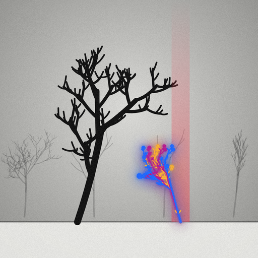

**Versión 4.6** · [Abrir en el navegador](https://loquellega.github.io/endeles/)

## Español

Endeles es un bosque espectral para escuchar caminando. Está hecho de árboles sin hojas, tinta, niebla y grano de película HP5. Cada sonido vive en un lugar del bosque: se oye a lo lejos, crece al acercarte y se mezcla con los demás.

Bajo seis de esos sonidos brilla una gema de color, lo único con color en el bosque gris. Cada una guarda un hexagrama del I Ching leído desde el cielo de este momento, desde tu nacimiento o desde tu tirada. Alrededor de cada gema crece un jardín de hierba, flores y polinizadores. Al leer una gema, se apaga y su luz pasa al jardín.

### Qué hace

- **Umbral en cuatro pasos:** el bosque, tus datos, tu pregunta y la tirada. Las seis líneas de milenrama construyen el bosque. El trigrama de abajo da el suelo, el de arriba la atmósfera, y las líneas que cambian lo transforman mientras caminas.
- **Seis gemas:** el Sol de hoy, la Tierra de hoy, la Luna de esta hora, tu Sol al nacer, lo que está adentro (el hexagrama nuclear de tu tirada) y la tirada misma.
- **I Ching en español:** versión libre de los 64 hexagramas desde el texto chino y la traducción de James Legge (1882), ambos de dominio público. Cada hexagrama trae «en pocas palabras», juicio, imagen y una pregunta de exploración. La guía «¿cómo se lee?» explica lo básico.
- **El claro de las semillas:** aquí crecen las semillas de [Xinas](https://github.com/loquellega/xinas). Cada una es el instante de alguien (un retrato, un minuto, un lugar) y se vuelve un arbusto de luz iridiscente, el único color del bosque además de las gemas. Crece un poco cada día y guarda el hexagrama de su instante, el mismo de la tira impresa: no se vuelve a tirar. Quien llega desde Xinas (`?s=CÓDIGO&t=MINUTO`) entra con una bienvenida propia, junto a su planta, marcada con un haz de luz. Al acercarte a cualquier planta, el bosque te dice su número, su fecha y su hexagrama. El botón «✦ tu semilla» y el mapa te regresan siempre a la tuya, y la interfaz toma su color.
- **Dos caminos junto a tu planta:** *solo verla crecer* (contemplar) o *preguntarle algo* (consultar). Al consultar, seis luces rodean la planta: son las seis líneas de su hexagrama, de la raíz a la flor, con una lectura del herbario en cada una. Todo se puede leer desde el primer día: es la experiencia de un momento.
- **El cierre:** al leer la última línea, al terminar de contemplar o al apagar todas las gemas de la tirada, la toma se abre con un gran angular, el clima se entibia y el sol vuelve: amanece antes de las 12 y atardece después. Un minuto de respiración guiada con campanas en la tónica de la semilla. Con las tiradas duras (12, 23, 29, 36, 39, 47) la toma se abre igual, pero la luz se queda como estaba: la lectura se entrega sin adornos.
- **Misión:** apagar las gemas del día. Hay un contador junto al mapa y, al terminar, el bosque se llena de luciérnagas.
- **Sonido espacial binaural:** espacios sonoros con radio pleno y alcance, fauna que responde al clima (ranas, grillos según la temperatura, búho, cuervos, carpintero) y la posibilidad de cargar tus propios MP3.
- **Clima:** seis climas que se funden entre sí, o el clima real de un lugar vía Open-Meteo (temperatura, humedad, viento, lluvia, visibilidad, sol real y marea del estanque).
- **Película HP5:** grano, contraste, exposición y viñeta.
- **Mapa y recorridos:** generador de bosques por semilla, mapa grande editable, recorridos de cámara grabados o trazados, y exportar/importar todo en JSON.
- **Escritorio y teléfono:** mouse y teclado, o joystick táctil. En teléfono las ventanas salen como hoja inferior. La calidad gráfica se adapta para sostener la fluidez.

### Instalación y uso

Es una página estática: no necesita base de datos. Solo el claro de las semillas usa un PHP pequeño (`semillas.php`).

1. Sube la carpeta completa a cualquier hosting, por ejemplo `/app/endeles/`, o usa GitHub Pages.
2. Ábrela por https. El audio y «mi ubicación» lo necesitan.
3. three.js va incluido en `lib/`. Sin internet funciona todo menos el clima real.
4. Se guarda en la pantalla de inicio del teléfono como app (en Safari: Compartir › «Agregar a inicio»): abre a pantalla completa, con su ícono y su carátula de arranque, y sin conexión una vez abierta. Para eso van junto a `index.html` el `manifest.webmanifest`, el `sw.js` y la carpeta `iconos/`. El semillero (`semillas.php`) siempre se consulta en la red.
5. Para el claro de las semillas, el hosting necesita PHP. `semillas.php` crea la carpeta `datos/` (cerrada al público con su `.htaccess`) y guarda ahí la lista: solo códigos, minutos y fecha de siembra, sin retratos, nombres ni IP. PHP debe poder escribir en la carpeta de Endeles. Sin PHP, como en GitHub Pages, el bosque funciona igual y muestra solo la semilla del enlace.

Controles de escritorio: clic para mirar con el mouse (Esc lo suelta), WASD o flechas para caminar, Shift para correr, E abre y cierra una gema, 1–6 cambia el clima, F la película, P reproduce un recorrido y H oculta la interfaz.

Para modificar la app, edita `desarrollo/src.html` o `fuente/*.js` y reconstruye con `python3 desarrollo/construir.py` (genera `index.html` y `escena.html`). El detalle completo está en [LEEME.txt](LEEME.txt).

### Endeles Escena (para teatro)

`escena.html` es el mismo bosque preparado para escena: escucha a [Alquimia EEG OSC](https://github.com/loquellega/alquimia-eeg-osc) y **cada persona que se pone el casco es un bosque distinto**. No tiene I Ching, gemas ni semillas: solo el bosque, sus cámaras y sus cues.

- **Firma:** al pulsar «nueva persona» (o con `/endeles/persona/nueva` por OSC) mide 45 s de señal válida. El promedio y la variación de cada banda deciden la semilla, la apertura del bosque, el relieve, el agua y cuántos animales lo habitan. El cambio ocurre tras una cortina a negro.
- **Clima vivo:** las bandas y métricas mueven la niebla, el viento, la bruma, las esporas, la luz, la viñeta y el contraste; el estrés hace que los animales callen. Un parpadeo es un destello y un trino. Si la señal deja de ser válida, el clima vuelve solo al reposo.
- **Diez cámaras y cues:** cada cue lleva a una cámara con corte, recorrido (la cámara viaja esquivando troncos) o fundido a negro, con duración, curva, altura del vuelo y clima opcional. GO con la barra espaciadora, desde el panel o con `/endeles/go`.
- **Montaje:** cámaras, cues y mapeo se guardan en el navegador y se exportan como `montaje.json` (si está junto a `escena.html` en un servidor, se carga solo).

**Conexión:** abre Alquimia EEG OSC (v0.8 o posterior); su relevo WebSocket queda en `ws://localhost:9203`. Los cues se mandan por OSC al puerto 9210 del puente desde Pixera, Isadora o QLab: `/endeles/go`, `/endeles/cue n`, `/endeles/cam n`, `/endeles/back`, `/endeles/persona/nueva`, `/endeles/persona/fijar`, `/endeles/clima n`, `/endeles/clima/congelar 0|1`, `/endeles/fade valor segundos`, `/endeles/ui 0|1`.

**Parámetros de la dirección:** `?auto=1` entra sin clic (para Pixera u otra salida), `&ui=0` imagen limpia, `&sim=1` simulación sin casco, `&puente=192.168.1.20:9203` otro puente, `&calibracion=30` segundos de medición, `&sonido=0` sin sonido.

**Teclas:** espacio o G = GO · B = atrás · [ ] = elegir el siguiente cue · 1–0 = corte a cámara · Shift+1–0 = guardar la vista en esa cámara · WASD camina libre · Q/Z sube y baja · H oculta la interfaz.

**Ojo:** una página servida por https no puede abrir `ws://` hacia otra computadora de la red. En función, abre `escena.html` como archivo local (o desde un servidor local por http) en la computadora que proyecta. El contrato completo está en el proyecto: *Endeles Escena: contrato OSC + JSON*.

## English

Endeles is a spectral forest to listen to while walking. Its leafless trees are drawn in ink, fog and HP5 film grain. Every sound lives in a place: you hear it from afar, it grows as you approach and blends with the others.

Under six of those sounds glows a colored gem, the only color in the grey forest. Each one holds an I Ching hexagram read from the sky at this moment, from your birth or from your own reading. A garden of grass, flowers and pollinators grows around each gem. Once you read a gem it goes dark, and its light passes into the garden.

### Features

- **Four-step threshold:** the forest, your details, your question and the reading. Six yarrow-stalk lines build the forest. The lower trigram shapes the ground, the upper one the atmosphere, and changing lines transform it as you walk.
- **Six gems:** today's Sun, today's Earth, this hour's Moon, your birth Sun, what lies within (the nuclear hexagram of your reading) and the reading itself.
- **I Ching in Spanish:** a free version of the 64 hexagrams based on the Chinese text and James Legge's 1882 translation, both public domain. Each hexagram has a plain summary, judgment, image and an exploration question. A short "how to read it" guide explains the basics.
- **Clearing of seeds:** seeds planted from [Xinas](https://github.com/loquellega/xinas) grow here as iridescent light shrubs, each one the moment of someone (a portrait, a minute, a place), with the same hexagram as its printed strip. Visitors arriving from Xinas get their own welcome next to their plant. They can just watch it grow, or ask it something and walk among the six lines of its hexagram; at the end the shot widens, the weather warms and the sun returns (sunrise before noon, sunset after), with a one-minute guided breath. Hard readings are delivered plainly, without the warm light. The «✦ tu semilla» button and the map always lead back to your own plant, and the interface takes its color. A small `semillas.php` keeps the list (codes and minutes only).
- **Mission:** switch off the day's gems. A counter sits next to the map, and when you finish, the forest fills with fireflies.
- **Binaural spatial audio:** sound spaces with full radius and reach, wildlife that reacts to the weather, and your own MP3 files.
- **Weather:** six blending presets, or live weather from Open-Meteo, including real sun position and the pond's tide.
- **HP5 film look**, a seed-based forest generator, an editable map, camera paths and JSON export/import.
- **Desktop and phone**, with adaptive rendering quality.

### Endeles Escena (for theatre)

`escena.html` is the same forest for the stage. It listens to Alquimia EEG OSC over WebSocket (port 9203): each person wearing the headset gets their own forest (a 45 s signature sets seed, openness, relief, water and wildlife) and their live EEG modulates the weather. Ten cameras and a cue list with GO (space bar or `/endeles/go` via OSC to the bridge's port 9210), with cut, travel or fade transitions. Use `?auto=1&ui=0` for Pixera or any clean output, `&sim=1` to test without a headset.

### Install

It is a static page: upload the folder to any web host or use GitHub Pages, and open it over https. The clearing of seeds needs PHP for `semillas.php` (it writes to a private `datos/` folder). three.js is bundled in `lib/`. To change the app, edit `desarrollo/src.html` or `fuente/*.js` and run `python3 desarrollo/construir.py`.

## Dominio propio / Own domain

Endeles vive en **https://endeles.hectorcruz.com.mx** (subdominio con raíz en esta misma carpeta). `semillas.php` acepta siembras desde cualquier `*.hectorcruz.com.mx` (CORS). Cuando el subdominio tenga SSL, `redireccion.htaccess` manda la ruta vieja `/app/endeles/` al dominio nuevo con el mismo enlace.

Endeles lives at **https://endeles.hectorcruz.com.mx**; `semillas.php` accepts seeds from any `*.hectorcruz.com.mx` origin, and `redireccion.htaccess` forwards the old path once the subdomain has SSL.

## Capturas / Screenshots

| | | |
|---|---|---|
| 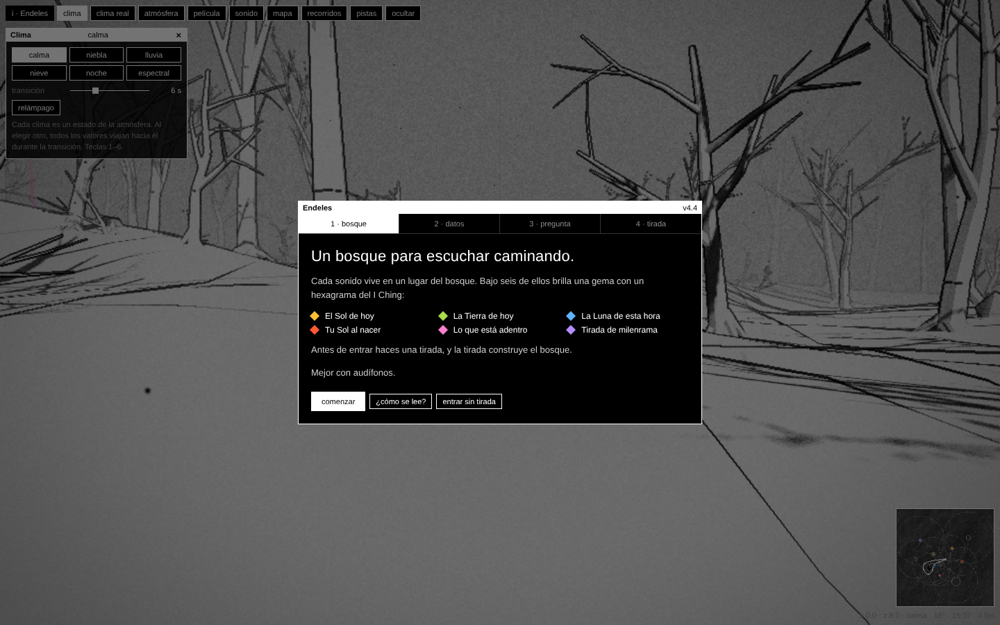 Umbral · Threshold |  La tirada construye el bosque · The reading builds the forest | 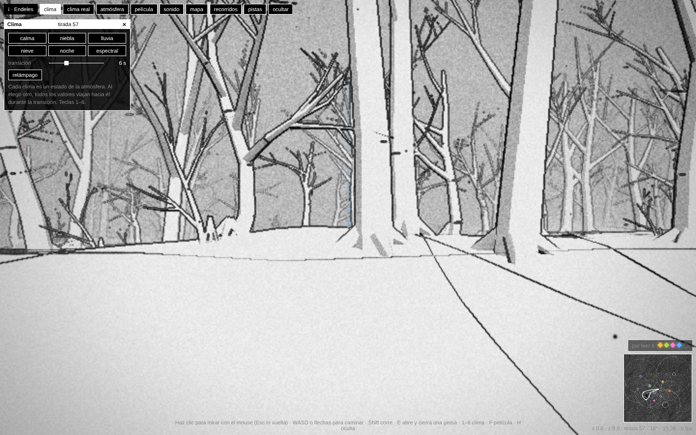 Llegada al bosque · Arrival |
|  Gema y jardín · Gem and garden | 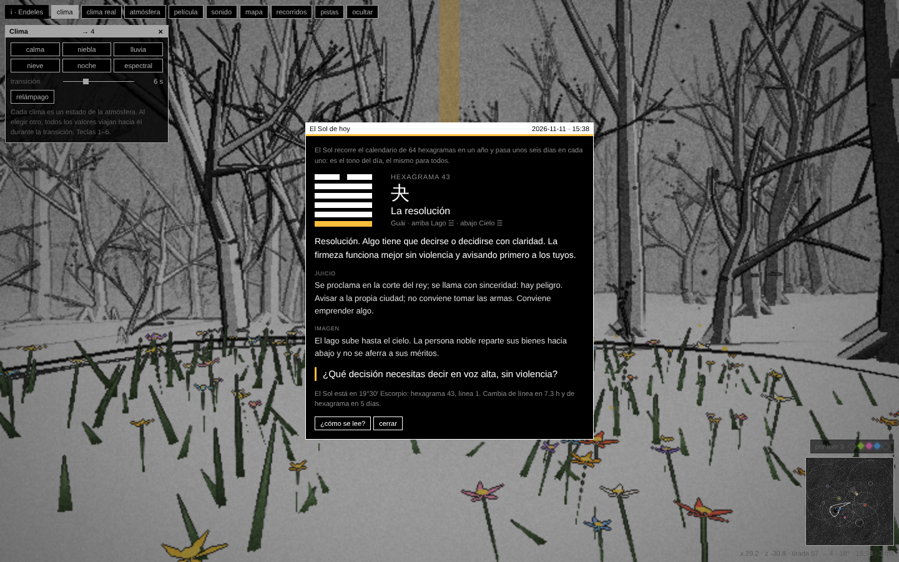 Pista del I Ching · I Ching clue |  ¿Cómo se lee? · How to read it |
|  Gema apagada, jardín en flor · Gem off, garden in bloom | 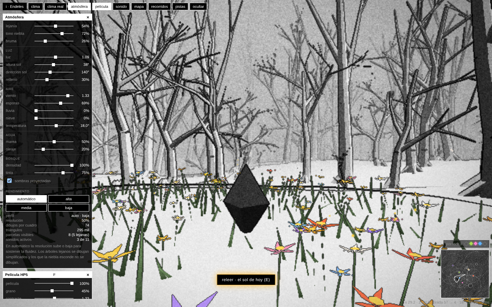 Clima, atmósfera y película · Weather, atmosphere, film | 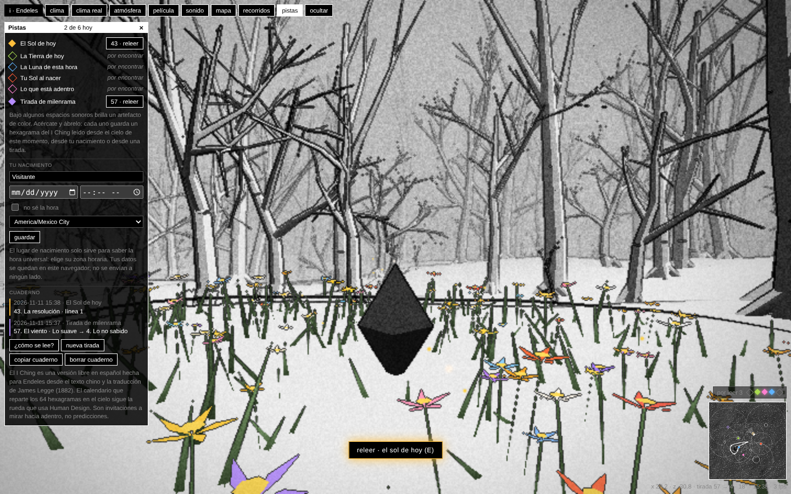 Pistas, nacimiento y cuaderno · Clues and notebook |
| 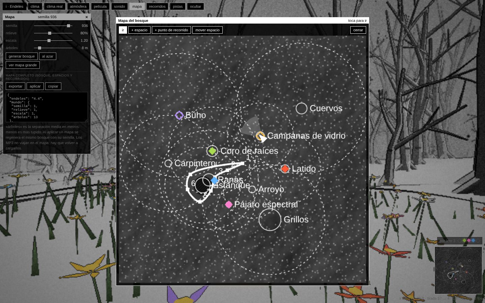 Mapa del bosque · Forest map | 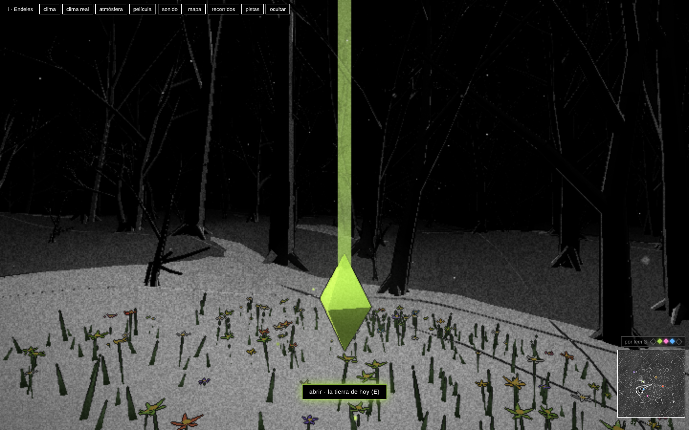 De noche · At night |  Teléfono: umbral · Phone: threshold |
| 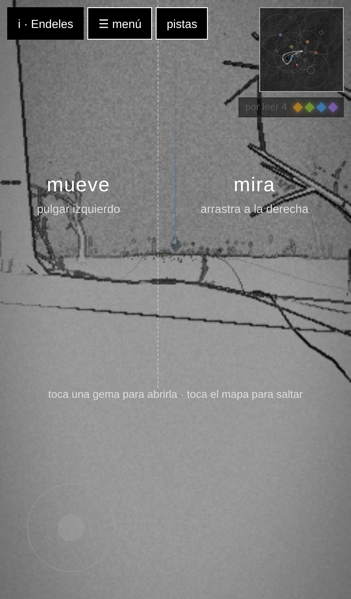 Teléfono: guía de manos · Phone: touch guide |  Teléfono: pista · Phone: clue | 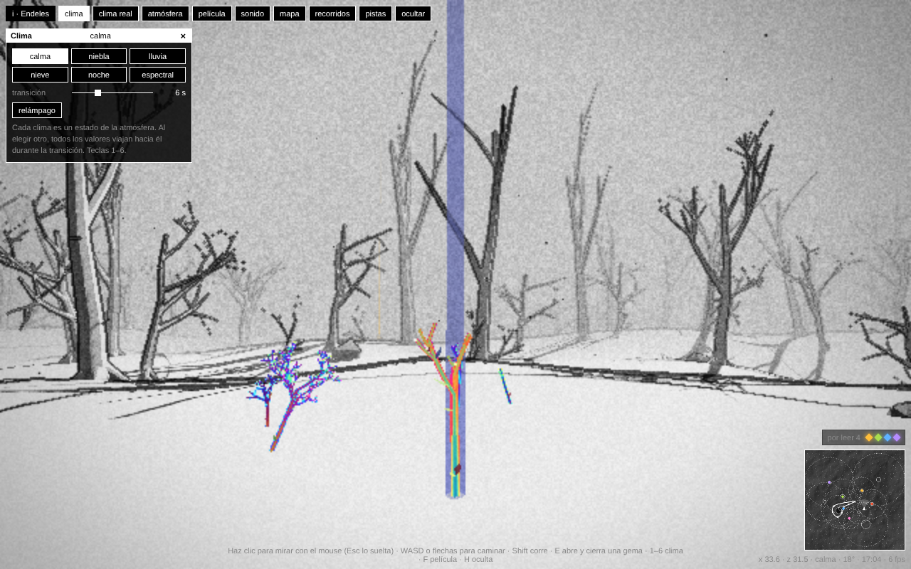 El claro de las semillas · Clearing of seeds |
| 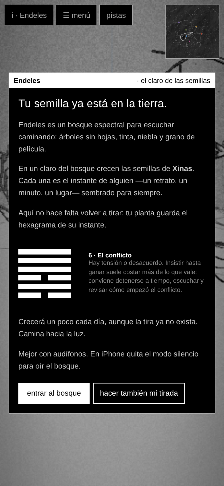 Llegada desde Xinas · Arrival from Xinas | | |

Nuevo en v5.0 / New in v5.0:

| | | |
|---|---|---|
| 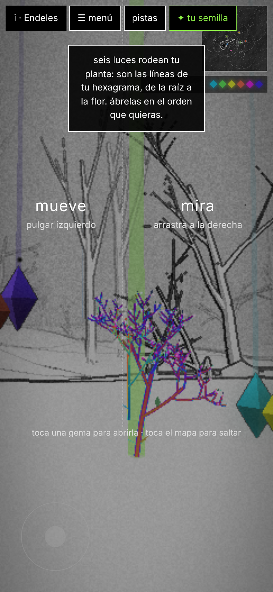 | 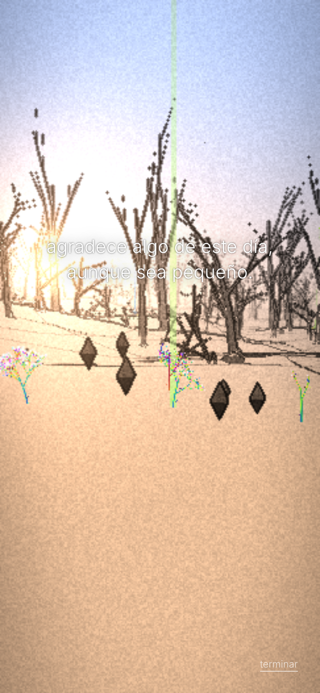 | 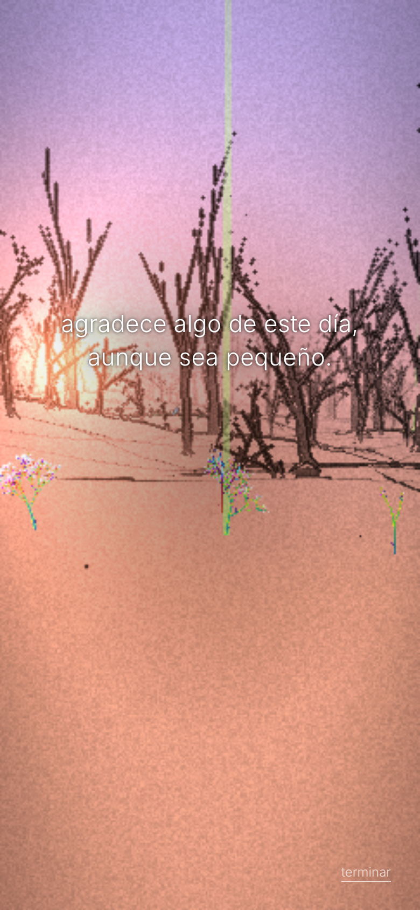 |
| Las seis líneas de tu semilla / The six lines of your seed | Cierre al amanecer / Closing at sunrise | Cierre al atardecer / Closing at sunset |

## Licencia / License

GPL-3.0-or-later. Ver / see [LICENSE](LICENSE). three.js es MIT (`lib/three-LICENSE.txt`). Los datos de clima vienen de [Open-Meteo](https://open-meteo.com), para uso no comercial. La rueda que reparte los 64 hexagramas en el calendario sigue el orden que usa Human Design; Endeles solo usa ese orden.

## Créditos / Credits

Diseño, investigación y desarrollo: Héctor Cruz Juárez — https://hectorcruz.com.mx  
Colección Alchemy of Meaning.
